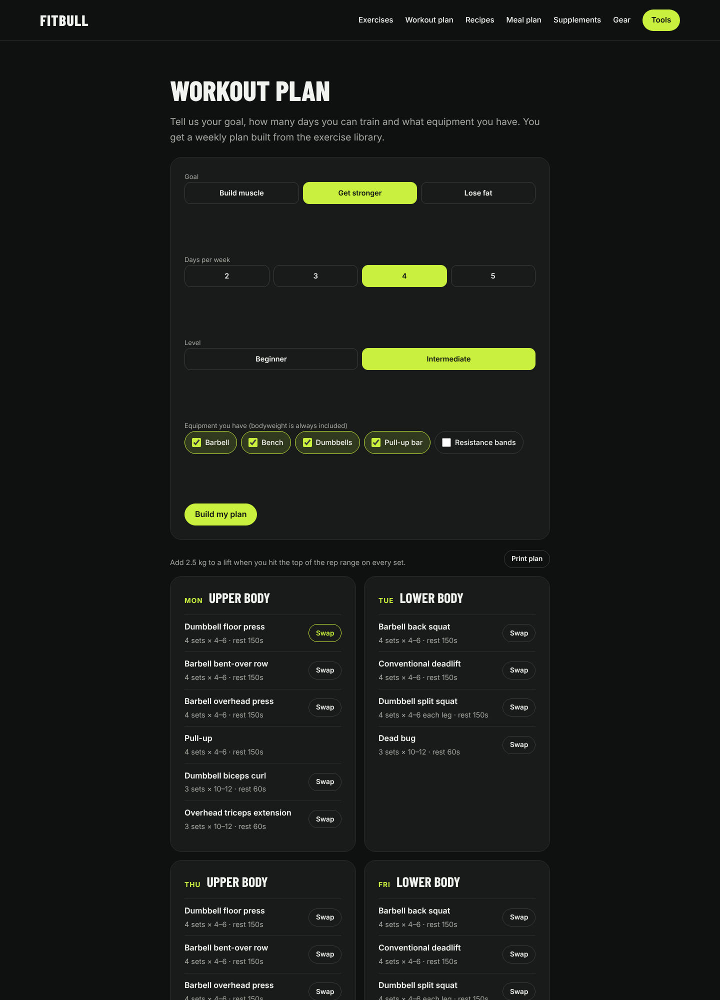
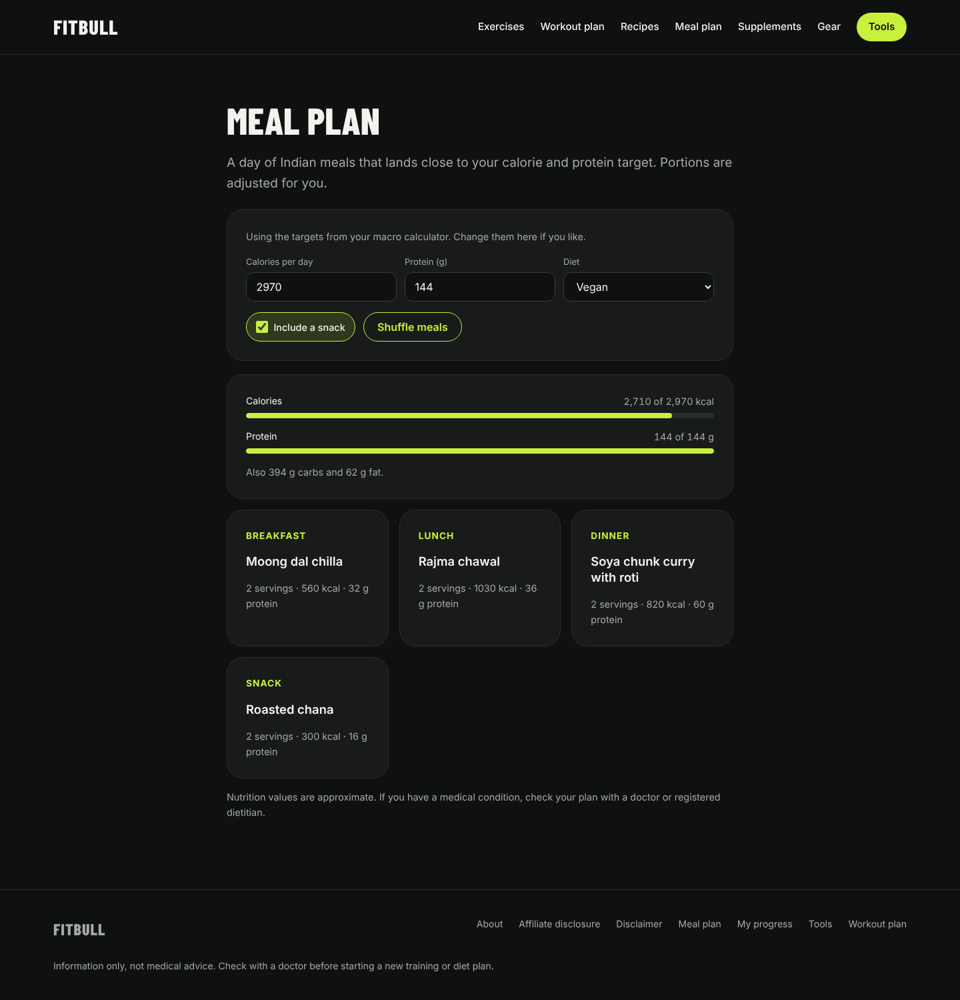
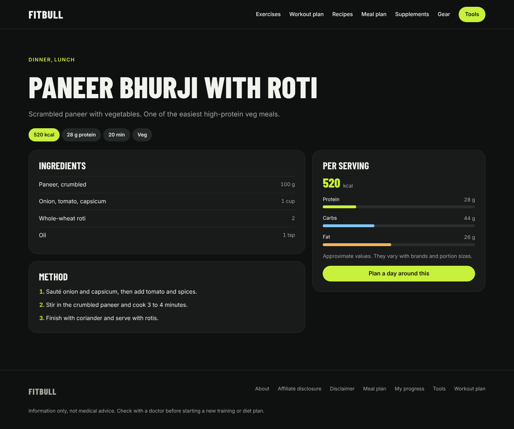
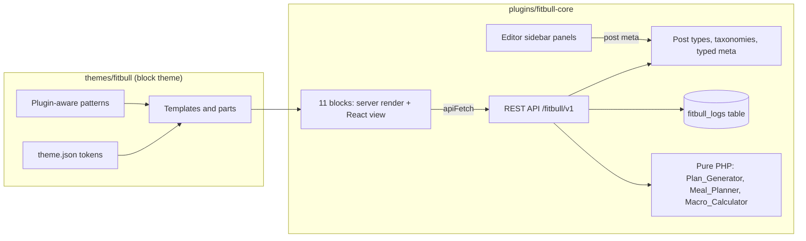

# Fitbull

A complete fitness platform built on WordPress: a workout plan generator, an exercise library, Indian recipes with a meal planner, macro and one-rep-max calculators, a private progress log, and gear and supplement guides.

It is a **custom block theme** plus a **custom plugin**. There are no page builders and no paid plugins. Interactive parts are React blocks backed by a custom REST API, and the planning logic is plain, unit-tested PHP.


**Live demo:** [Open in WordPress Playground](https://playground.wordpress.net/?blueprint-url=https://raw.githubusercontent.com/ArponSamanta/fitbull/main/blueprint.json). It runs in your browser for free, with demo content loaded and you logged in.

## Features

| Feature | How it works |
| --- | --- |
| **Workout plan generator** | Goal, days (2–5), level and equipment produce a weekly split (full body, upper/lower, or push/pull/legs). It fills movement-pattern slots with matching exercises and sets reps and rest by goal. It reports gaps instead of faking them, and offers one-click swaps. The rules live in a pure PHP class with tests. |
| **Meal planner** | It searches recipe combinations and portion sizes (0.5–2 servings) to land near a calorie and protein target, respects diet rules (vegan ⊂ veg ⊂ eggetarian ⊂ non-veg) and can shuffle between the best plans. It reads targets from the macro calculator. |
| **Macro calculator** | Mifflin-St Jeor BMR, activity and goal from one JSON config shared by the JS block and the PHP endpoint, with tests in both languages. |
| **One-rep max** | The average of the Epley and Brzycki formulas, with a working-weight table rounded to 2.5 kg plates. |
| **Progress log** | Signed-in users log bodyweight and lifts in a custom table (created with `dbDelta`). It shows an SVG trend chart and best estimated maxes. Owner-only REST routes use nonces. Includes a privacy exporter and eraser, and the data is removed on uninstall. |
| **Exercise library** | 24 exercises with steps, mistakes, muscles, equipment and movement pattern. Filtered by REST and server-rendered first for SEO. |
| **Recipes** | 16 Indian recipes with macros, ingredients and method, filtered by diet, meal and minimum protein. |
| **Gear and supplements** | A home-gym kit builder in buying order by budget tier, and supplements rated by evidence. |
| **Editor experience** | Sidebar panels for every structured field, a calorie sanity check for recipes, and a one-click demo importer under Tools. |
| **Theme** | `theme.json` design tokens, self-hosted fonts, patterns, and templates for every content type. It works without the plugin and hides plugin-only sections. |
| **Quality** | ESLint, Stylelint, Jest, PHPUnit and the build run in GitHub Actions. It passes WordPress.org's Plugin Check and Theme Check. |

| Workout plan | Meal plan | Recipe | Mobile |
| --- | --- | --- | --- |
|  |  |  |  |

## Architecture



Every block renders real HTML on the server first, so it is crawlable and works without JavaScript. React then mounts on the same element using JSON props in a `data-` attribute. WordPress loading code stays thin; decisions live in pure classes that PHPUnit tests without WordPress.

### REST API (`/wp-json/fitbull/v1`)

| Endpoint | Purpose |
| --- | --- |
| `GET /exercises?muscle=&equipment=&difficulty=&search=&page=&per_page=` | Filtered exercises, easiest first |
| `GET /filters` | Muscle and equipment terms in use |
| `GET /recipes?diet=&meal=&min_protein=&per_page=` | Recipes, highest protein first |
| `GET /workout-plan?goal=&days=&level=&equipment=` | A weekly plan |
| `GET /meal-plan?calories=&protein_g=&diet=&include_snack=&variant=` | A day of meals |
| `GET /macros?sex=&age=&height_cm=&weight_kg=&activity=&goal=` | Calorie and macro targets |
| `GET, POST /logs` and `DELETE /logs/{id}` | The signed-in user's progress log (401 if logged out, owner-only deletes) |

Every parameter is typed and validated by the route schema, so bad input gets a 400 before any code runs.

## Run it locally

You need Docker Desktop. Node 20+ is only needed to change the React code.

```bash
git clone https://github.com/ArponSamanta/fitbull.git
cd fitbull
docker compose up -d
```

Open http://localhost:8080 and finish the WordPress install. Then:

```bash
docker compose run --rm wpcli wp theme activate fitbull
docker compose run --rm wpcli wp plugin activate fitbull-core
docker compose run --rm wpcli wp fitbull seed
```

You can also skip the last command and use **Tools > Fitbull demo content** in wp-admin.

### Development

```bash
cd plugins/fitbull-core
npm install
npm start                     # rebuild blocks on save
npm test                      # Jest
npm run lint:js && npm run lint:css
composer install && vendor/bin/phpunit
npm run build                 # commit build/ afterwards
```

`bin/package.sh` builds the WordPress.org zips into `dist/`. See [docs/PUBLISHING.md](docs/PUBLISHING.md) for the live demo and directory submission.

## Project structure

```
fitbull/
├─ docker-compose.yml          WordPress + MySQL + WP-CLI
├─ blueprint.json              WordPress Playground demo
├─ bin/package.sh              Release zips
├─ themes/fitbull/             Block theme: theme.json, templates, parts, patterns, fonts
└─ plugins/fitbull-core/
   ├─ fitbull-core.php         Bootstrap: hooks only
   ├─ includes/                Data model, REST controllers, pure engines, log table, admin, CLI
   ├─ src/blocks/              11 blocks (block.json, React, render.php, SCSS)
   ├─ src/components/          React UIs
   ├─ src/lib/                 Pure JS logic + Jest tests
   ├─ src/editor/              Editor sidebar panels
   ├─ assets/ui.css            Shared block UI styles
   ├─ data/                    Calculator config, demo content
   ├─ languages/               .pot translation template
   └─ tests/php/               PHPUnit tests
```

## Design decisions

- **Theme for looks, plugin for features.** The plugin works under any block theme, and the theme stands alone as a blog theme.
- **Pure engines, thin WordPress glue.** `Plan_Generator`, `Meal_Planner` and `Macro_Calculator` take arrays and return arrays, so they are fast to test and easy to reason about.
- **Honest output.** The planner reports missing movement patterns rather than inventing exercises. Nutrition is labelled approximate, and every tool carries a not-medical-advice line.
- **A custom table for the log.** Logs are many small private rows per user, which fits a table better than post meta. It has an index on `(user_id, logged_on)` and goes through `$wpdb->prepare` with `%i` identifiers.
- **Zero running cost.** Free tools, self-hosted fonts, and a Playground demo instead of paid hosting.

## Disclaimer

Content and tools give general information, not medical advice.

## License

GPL-2.0-or-later, like WordPress.
