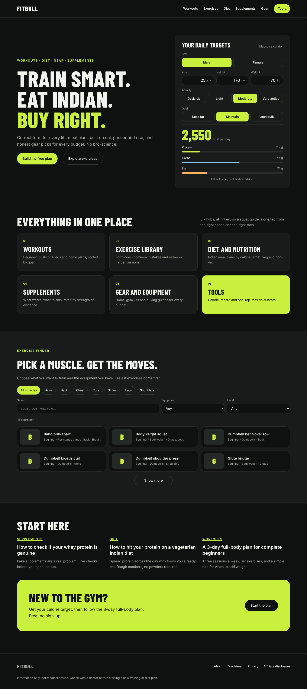
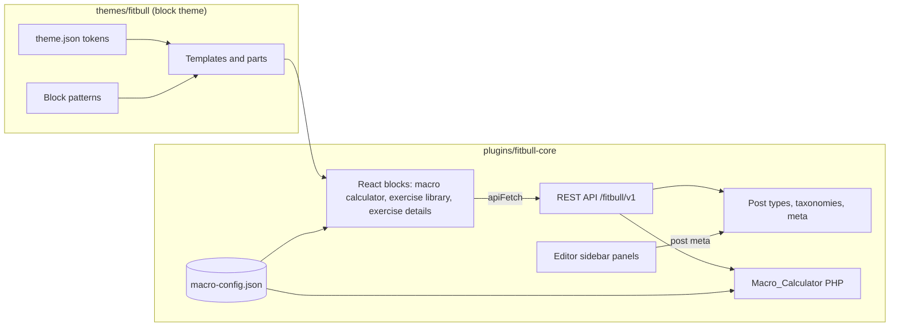
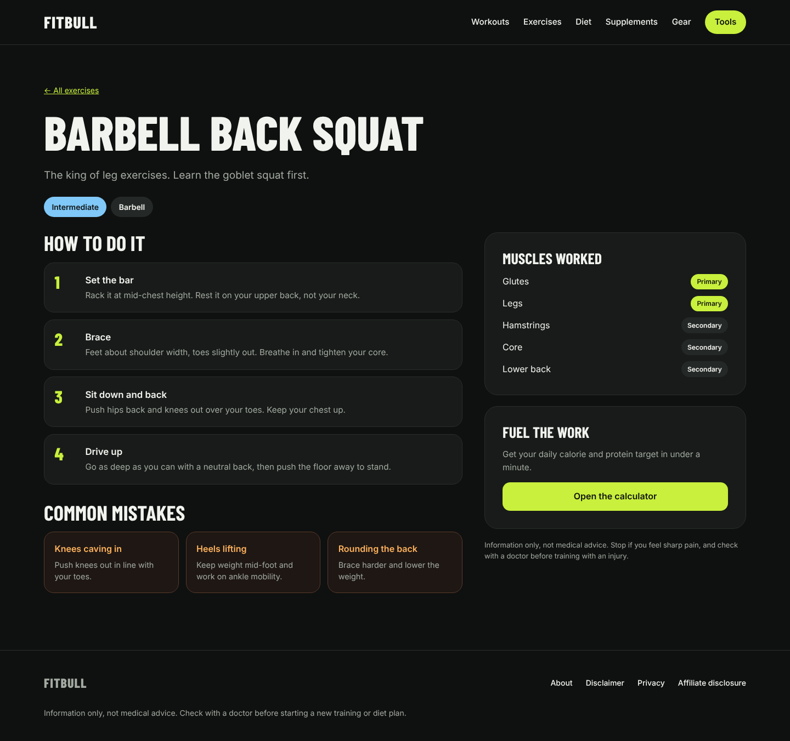
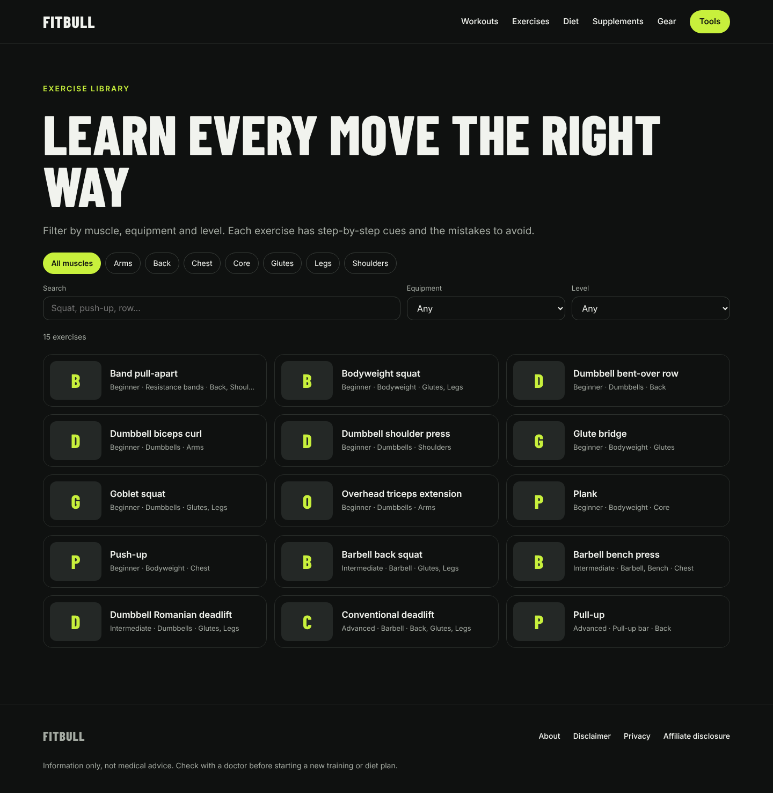
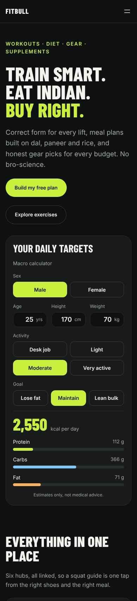
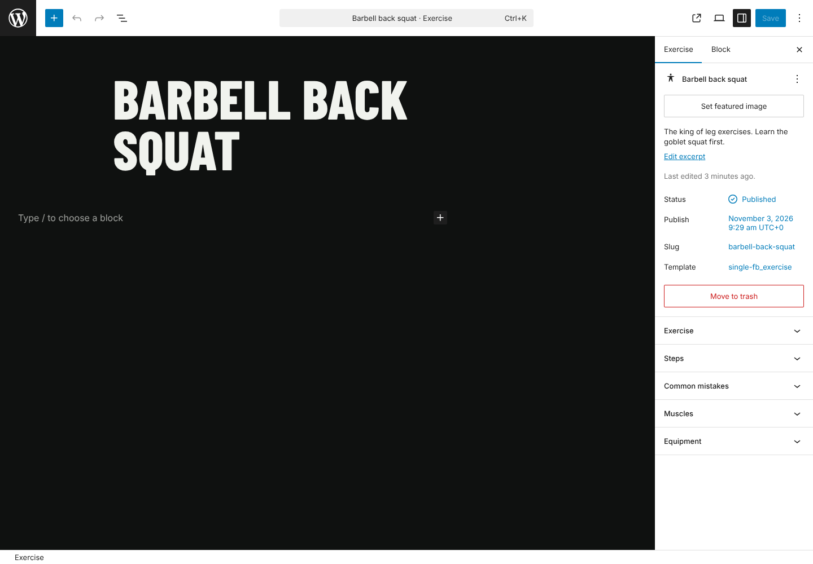

# Fitbull

A modern, interactive fitness website built on WordPress: an exercise library with correct-form guides, Indian diet advice, honest gear and supplement guides, and a live macro calculator.

It is a **custom block theme** plus a **custom plugin**, with no page builders or premium plugins. The interactive parts are React blocks backed by a custom REST API.



**Live demo:** [Open in WordPress Playground](https://playground.wordpress.net/?blueprint-url=https://raw.githubusercontent.com/ArponSamanta/fitbull/main/blueprint.json). It runs entirely in your browser, free, with demo content preloaded.

## Features

| Feature | How it works |
| --- | --- |
| Macro calculator | React block. Mifflin-St Jeor BMR, activity and goal from one shared JSON config, used by both the JS block and the PHP REST endpoint. Inputs are remembered in the browser. |
| Exercise library | React block that filters by muscle, equipment and level via `GET /wp-json/fitbull/v1/exercises`. The server renders the first page so it is crawlable and works without JavaScript. |
| Exercise pages | Dynamic block that renders steps, common mistakes, muscles worked and a form video from structured post meta. |
| Structured content | Custom post types for exercises, gear and supplements, with muscle and equipment taxonomies and typed, REST-exposed meta. |
| Editor experience | Sidebar panels in the block editor (React, `@wordpress/editor`) to edit steps, mistakes, difficulty, prices and evidence ratings. |
| Design system | `theme.json` tokens (colour, type, spacing), self-hosted Inter and Barlow Condensed, block patterns for every homepage section, and responsive down to 360 px. |
| Demo content | `wp fitbull seed` loads 15 exercises, gear, supplements, articles and pages. Safe to re-run. |
| Quality | ESLint, Stylelint, Jest and PHPUnit run in GitHub Actions on every push. |

## Architecture



### REST API

| Endpoint | Purpose |
| --- | --- |
| `GET /wp-json/fitbull/v1/exercises?muscle=&equipment=&difficulty=&search=&page=&per_page=` | Filtered exercises, easiest first, paginated (`X-WP-Total` headers) |
| `GET /wp-json/fitbull/v1/filters` | Muscle and equipment terms that have exercises |
| `GET /wp-json/fitbull/v1/macros?sex=&age=&height_cm=&weight_kg=&activity=&goal=` | Calorie and macro targets, validated, 400 on bad input |

## Run it locally (Windows, macOS or Linux)

You need Docker Desktop. Node 20+ is only needed to change the React code.

```bash
git clone https://github.com/ArponSamanta/fitbull.git
cd fitbull
docker compose up -d
```

Open http://localhost:8080 and finish the WordPress install. Then activate everything and load the demo content:

```bash
docker compose run --rm wpcli wp theme activate fitbull
docker compose run --rm wpcli wp plugin activate fitbull-core
docker compose run --rm wpcli wp fitbull seed
```

The theme and plugin folders are mounted into the container, so edits show up on refresh.

### Working on the blocks

```bash
cd plugins/fitbull-core
npm install
npm start          # rebuilds on save
npm test           # Jest unit tests
npm run lint:js
npm run build      # production build (commit the build folder)
composer install && vendor/bin/phpunit   # PHP unit tests
```

## Project structure

```
fitbull/
├─ docker-compose.yml        WordPress + MySQL + WP-CLI
├─ blueprint.json            WordPress Playground live demo
├─ themes/fitbull/           Block theme: theme.json, templates, parts, patterns, fonts
└─ plugins/fitbull-core/
   ├─ fitbull-core.php       Bootstrap
   ├─ includes/              Post types, meta, REST controller, calculator, WP-CLI
   ├─ src/blocks/            Block sources (block.json, React, render.php, SCSS)
   ├─ src/components/        Shared React components
   ├─ src/lib/               Pure JS logic + Jest tests
   ├─ src/editor/            Block editor sidebar panels
   ├─ data/                  Shared calculator config, demo content
   ├─ tests/php/             PHPUnit tests
   └─ build/                 Compiled assets (committed)
```

## Design decisions

- **Block theme instead of a page builder.** It keeps the front end fast and lets editors change layouts without code.
- **One calculator config for PHP and JS.** The block and the API can never disagree, and both have tests that check the same numbers.
- **Server-rendered first, then hydrated with React.** Pages are indexable and usable before scripts load. React takes over for filtering.
- **Meta, not page content, for exercises.** Steps and mistakes are structured data, so they can be reused in the API, filters or a future app.
- **Zero running cost.** Free tools only, self-hosted fonts, and a Playground demo instead of paid hosting.

## Screenshots

| Exercise page | Exercise library | Mobile |
| --- | --- | --- |
|  |  |  |



## Roadmap

- Workout plan generator (goal, days and equipment produce a weekly plan)
- Indian meal planner driven by the calculator's targets
- One-rep-max calculator and progress log for signed-in users
- Gear comparison and budget-builder blocks

## Disclaimer

Content is general information, not medical advice.

## License

GPL-2.0-or-later, like WordPress.
